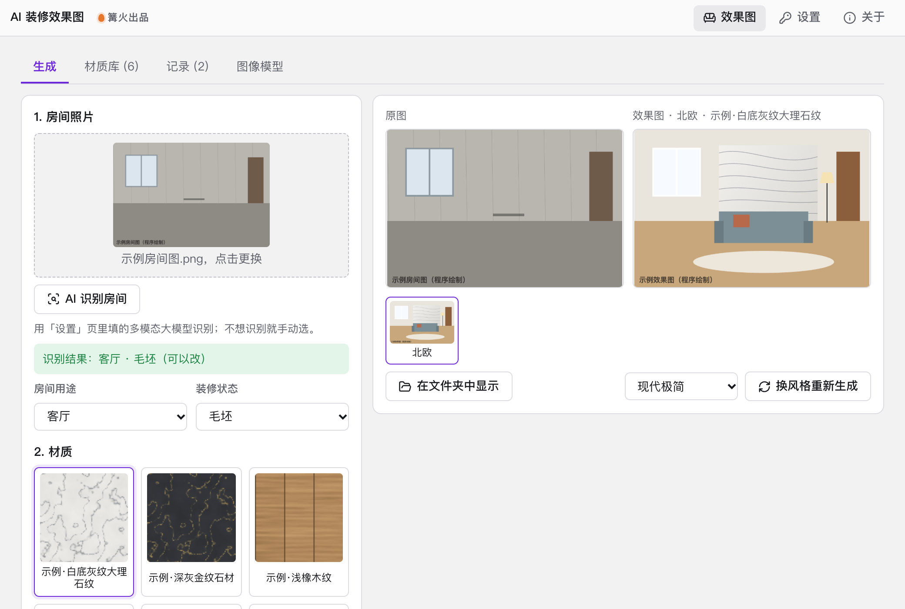

# AI 装修效果图

> 篝火出品 · 收录于篝火 App 应用区

上传房间照片，选材质和风格，用自填的图像模型生成装修效果图



## 下载

到 [Releases](https://github.com/campfire-code/ai-room-render/releases/latest) 下载对应安装包：

| 电脑 | 文件 |
|---|---|
| Windows 10 / 11 | `ai-room-render_版本号_windows-x64-setup.exe` |
| Mac（Apple 芯片） | `ai-room-render_版本号_mac-arm64.dmg` |
| Mac（Intel 芯片） | `ai-room-render_版本号_mac-x64.dmg` |

第一次打开：
- **Windows**：如果弹出「Windows 已保护你的电脑」，点「更多信息」→「仍要运行」。
- **Mac**：如果提示「无法验证开发者」，打开「系统设置 → 隐私与安全性」，在下方点「仍要打开」。

## 怎么用

**第一次使用先设置图像模型**（本工具不内置任何密钥或模型）：
1. 打开「图像模型」页签，填接口地址、密钥、模型名。接口需要兼容 OpenAI 图像接口格式：改图走 `POST {接口地址}/images/edits`（multipart，多张图用重复的 `image[]` 字段），文字生图走 `POST {接口地址}/images/generations`（JSON）；返回 `data[0].b64_json`（也兼容返回 `data[0].url` 的服务）。其他服务商是否兼容，以它自己的文档为准。
2. 想用「AI 识别房间」，再到右上角「设置」页填一个支持看图的多模态大模型（同样兼容 OpenAI 格式）；不填也行，手动选房间类型即可。

**生成效果图**：
1. 「生成」页拖入或选择房间照片（JPG / PNG / WebP；苹果 HEIC 请先转成 JPG）。
2. 点「AI 识别房间」自动填房间用途和装修状态，识别不对可以直接改；识别出非室内照片会提示换一张。
3. 选材质（内置 6 种示例材质，也可以到「材质库」添加自己的：名称 + 贴图或参考图 + 描述）、用在哪里（按房间推荐）、8 种装修风格，选「保留原房间结构」可让门窗、墙体、视角保持不变。
4. 选好保存文件夹，点「生成效果图」。生成要 20～60 秒，具体看模型和服务商，费用由服务商按其规则计算。
5. 右侧并排显示原图和效果图；下方是本张照片已生成的几个版本，点缩略图切换。用「换风格重新生成」换一种风格再出一张。
6. 每张图连同一个同名 `.json` 参数文件保存在所选文件夹；「记录」页可查看每次的房间、风格、材质、模型、尺寸和完整提示词，并一键套用参数。记录里不含密钥。

**说明**
- 「改图」模式把照片作为底图交给模型，并可附上材质图作为第二张参考图；「只用文字生成」模式不参考照片，无法保持原房间结构。
- 内置示例材质的纹理由程序生成，不含任何品牌或真实产品图。
- 照片、密钥只在本机和你填写的接口之间传输；效果图是 AI 生成的示意，不代表实际施工效果。

## 验收用例

以下用例不需要真实接口的前两条可以直接验证界面；第 3 条需要你自己的图像模型。示例文件都是程序绘制的示意图，不是真实照片。

| 操作 | 应得到 |
|---|---|
| 打开「材质库」，名称留空点「添加到材质库」 | 提示「请填写材质名称」；名称填「测试」、描述和贴图都不填，提示「材质贴图和描述至少填一项」 |
| 材质库添加：名称「深橡木」，贴图选 `samples/示例材质贴图-浅橡木纹.png`，描述填 `dark oak wood grain` | 材质库变为 7 种，「生成」页材质列表里出现「深橡木」；内置的 6 种示例材质没有删除按钮，自己添加的有 |
| 不填图像模型直接去「生成」页 | 「生成效果图」按钮不可点，下方提示去「图像模型」页签设置 |
| 填好图像模型；「生成」页选 `samples/示例房间图-毛坯客厅.png`，房间选客厅、状态选毛坯，材质选「示例·白底灰纹大理石纹」，位置选背景墙，风格选北欧，点生成 | 右侧并排出现原图和效果图；保存文件夹里有 `客厅-北欧-…-时间.png` 和同名 `.json`，json 里是本次参数和提示词，没有密钥 |
| 再点「换风格重新生成」选「现代极简」 | 生成第二张，缩略图条里有两个版本可切换；文件夹里多一组图片和 json |
| 打开「记录」页 | 有 2 条记录，展开可见模型、尺寸、完整提示词；点「套用这些参数」回到生成页并带上当时的选择 |
| 设置里不填大模型，点「AI 识别房间」 | 提示「还没有设置大模型……」，手动选择仍可继续 |

## 自己编译

需要 Node.js 22、pnpm、Rust。

```bash
pnpm install
pnpm test          # 单元测试
pnpm tauri dev     # 开发运行
pnpm tauri build   # 打包
```

界面框架在 `src/kit`（所有 campfire-code 工具共用），本工具的逻辑在 `src/tool`。

## 归属

本工具由**篝火**出品，是篝火 App 应用区收录的开源工具之一，由篝火（GitHub 组织 [campfire-code](https://github.com/campfire-code)）维护与更新。全部工具的目录见 [toolkit-hub](https://github.com/campfire-code/toolkit-hub)。

## 许可证

MIT，版权方为篝火（campfire-code）。
